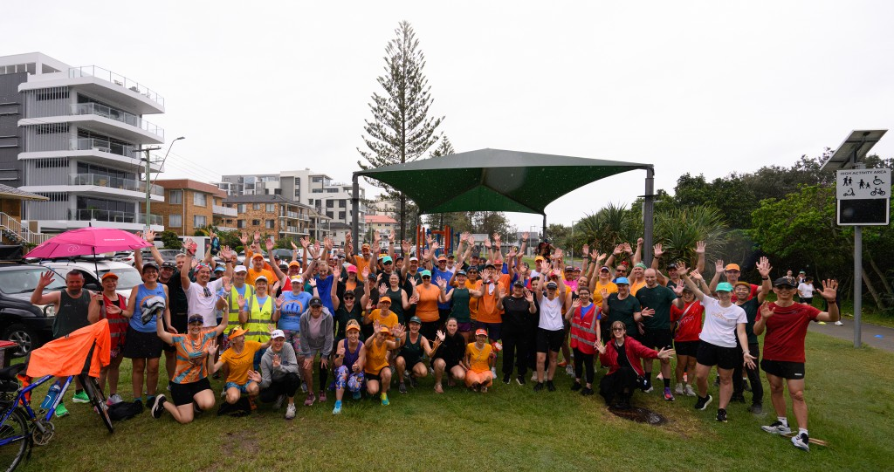
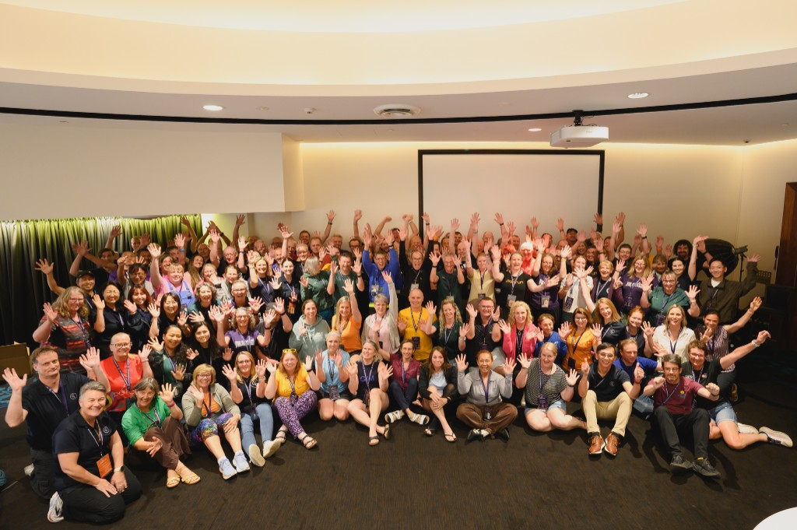

This time last week I was in [Coolangatta] for the parkrun Asia Pacific Ambassador Conference 2026. The theme was *Grow the Knowledge, Strengthen the Connection*. It was my third APAC-wide conference, and the first such conference in more than four years. I was there as a participating delegate: one ambassador among nearly a hundred, most of whom I had never met, or rarely see, because they do not live in Melbourne.

As one of my fellow ambassadors said at dinner on Saturday, it was unusual to be out of our usual contexts, where we are often the biggest parkrun enthusiasts, into one where we sit much farther left on the bell curve. To emphasise the point, when [Stevie Wring] (a Non-executive Director of parkrun Australia and the Interim Managing Director of parkrun Asia Pacific) conducted a quiz in her opening address, I scored a measly six out of sixteen. I learned a lot over the weekend. The takeaway that stuck, though, was more important than trivia: how do we grow the connections?

## Friday: bowls, dinner, and who is not at parkrun

It was good to meet people face-to-face, even as an introvert. At lawn bowls on Friday afternoon I got to meet folks from across APAC and establish common connections before the formal programme began.

Before Friday's welcome dinner, [Chair of the Board][scott-board] Scott Watkins gave an address focussed on "Who is not at parkrun". He talked about the success [Albert Melbourne parkrun] has had engaging with international students. It reinforced the importance of providing a welcoming environment for all, regardless of experience or background. Everyone is welcome to walk, jog, run, volunteer, or spectate.

## Saturday morning: Kirra in the rain

Saturday started, of course, with [Kirra parkrun] event [#696], in the rain. I enjoyed the run, my second at Kirra. It was spectacular to see what a wide range of experience my fellow ambassadors have, from their pace to their colourful milestone shirts. Everyone was having fun despite the conditions.

<figure class="caption-centred">
  
  <figcaption markdown="1">
Ambassadors at [Kirra parkrun] event [#696] in the rain: hands up, milestone shirts, and at least one pink volly brolly.
([More photos from the morning][kirra-facebook].)
  </figcaption>
</figure>

## Opening the day

The official conference sessions were hosted by [Lisa Millar][lisa-abc]: an experienced MC and an enthusiastic parkrun participant. She had some great anecdotes about taking her film crews to parkrun when they were on the road filming for *Muster Dogs* and *Back Roads*.

Later, a role-based breakout was a good opportunity to talk with my fellow Regional Event Ambassadors (REAs) about the challenges we face in our roles. The afternoon panel on growing the network and relationship building reinforced my own experiences, and was entertaining with it. Kudos to the folks who took part.

## Impact stories

The impact block was a real highlight, again MC'd by Lisa.

[Curtis McGrath] OAM talked about the important impact of [Invictus Australia] and [Team Veteran] on veterans' health outcomes, and those of their families. Curtis's introduction provided valuable context for Clarrie's story. Clarrie demonstrated how from little things big things grow: from his first (and only?) time walking at his local event when encouraged to go, to running at Kirra that morning. He is well on his way to his 200 milestone shirt and has completed a number of the [Running Challenges], including the Bushy Pilgrimage, massively improving his physical and mental wellbeing. Inspiring.

[Karl] talked about experiencing a cardiac arrest at [Wallaby Track parkrun] and the importance of defibrillation, something that resonates with [this blogger][cardiac-arrest].

[Pat] presented at the previous conference, and it was great to see him looking so well even while living with a motor neurone disease (MND) diagnosis. His artwork is incredible, and so is he.

Clarrie's and Pat's stories really highlighted to me the importance of welcoming first-timers.

## Speed Freaks

Before Saturday's evening meal Lisa introduced [Speed Freaks]. What an incredible organisation. Very closely aligned with parkrun's values, as demonstrated by parkrun founder Paul Sinton-Hewitt mentoring founder [Anna] in starting up. I do not think there was a dry eye in the house as [Jordyn] described her journey from addiction to recovery and the acceptance she found in the parkrun community.

<figure class="caption-centred">
  
  <figcaption>
    Hands up for connection: the parkrun APAC Ambassador Conference 2026 group photo at Twin Towns.
  </figcaption>
</figure>

## Sunday: coffee, market, buzz

On Sunday morning my roommate Marcus and I took it easy, enjoying the coffee and the local market. We caught up with some new friends at the airport and soaked up the post-conference buzz. I would have loved to have been ready for a show-and-tell of various [parkrun utilities] on this site; next time, perhaps.

## Behind the numbers

I am a parkrun stats nerd, and I have always maintained that behind the numbers are real stories. Coolangatta put a few more of those stories in front of me: first-timers finding their feet, recovery finding a community, ambassadors choosing connection over comfort. I came home more determined than ever to help grow the connection by surfacing stories like theirs where I can, so more people get to experience the weekly social, active joy of parkrun, especially those who still think a free, weekly, timed 5 km event is not for them.

<!-- Links -->

[Albert Melbourne parkrun]: https://www.parkrun.com.au/albertmelbourne/
[Anna]: https://speedfreaks.org.nz/our-people/ "Anna Christophorou, Chief Executive and founder of Speed Freaks"
[cardiac-arrest]: 
[Coolangatta]: https://en.wikipedia.org/wiki/Coolangatta,_Queensland
[Curtis McGrath]: https://invictusaustralia.org/invictus-australia-team/ "Curtis McGrath OAM, Invictus Australia Ambassador"
[Invictus Australia]: https://invictusaustralia.org/
[Jordyn]: https://speedfreaks.org.nz/our-people/ "Jordyn Yee, Programme Coordinator Ōtautahi, Speed Freaks"
[Karl]: https://youtu.be/GVtyRkpRi9Y "Karl Robson on cardiac arrest at Wallaby Track parkrun"
[Kirra parkrun]: https://www.parkrun.com.au/kirra/
[kirra-facebook]: https://www.facebook.com/media/set/?vanity=kirraparkrun&set=a.1477425201216988
[lisa-abc]: https://www.abc.net.au/news/lisa-millar/166890 "Lisa Millar on ABC News"
[#696]: https://www.parkrun.com.au/kirra/results/696/
[parkrun utilities]: https://www.johnsy.com/parkrun-utilities/
[Pat]: https://www.youtube.com/watch?v=y8GT4GA7mrw "Pat Kinsella's story"
[Running Challenges]: https://running-challenges.co.uk
[scott-board]: https://blog.parkrun.com/au/2026/01/06/parkrun-australia-board-announcement/
[Speed Freaks]: https://speedfreaks.org.nz/
[Stevie Wring]: https://blog.parkrun.com/au/2026/01/06/parkrun-australia-board-announcement/
[Team Veteran]: https://invictusaustralia.org/team-veteran/
[Wallaby Track parkrun]: https://www.parkrun.com.au/wallabytrack/
